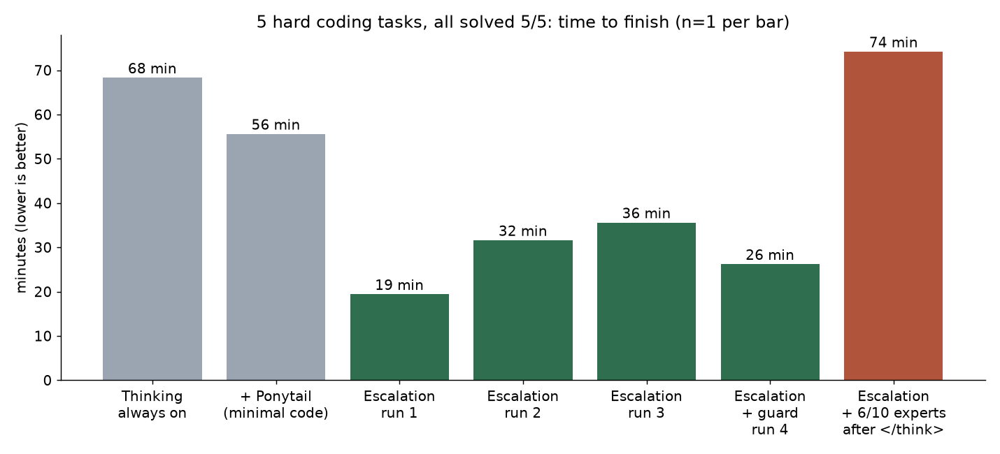
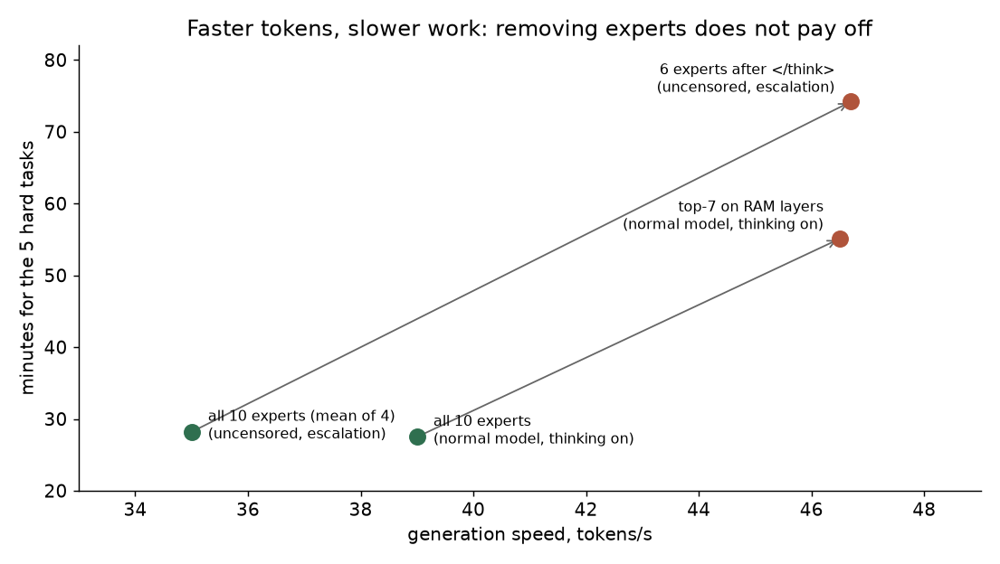

# qwen-consumer-pc

**Run the full Qwen3.8-Flash-Next (125B MoE, 2-bit) on a gaming PC: 16 GB VRAM + 32 GB RAM, ~39 tokens/s, with stock llama.cpp.**
Plus a small proxy that keeps "thinking" off until the model actually fails, which cut the time to finish hard coding tasks from 68 to ~28 minutes in our (small) benchmark.

*Italiano: [più sotto](#italiano).*

| Measured on one PC | RTX 4080 SUPER 16 GB · Ryzen 7 7800X3D · 32 GB DDR5-5600 · Windows 11 |
|---|---|
| Generation speed | **~39 tok/s** normal model (38.4–40.5), **~35 tok/s** uncensored (abliterated) model |
| Prompt reading | ~860 tok/s warm, ~230–440 tok/s in real agent sessions |
| HumanEval (164) | 154/164 thinking off · ~163/164 thinking on (re-running only the failed ones) |
| 5 hard multi-file coding tasks | **5/5**, mean **~28 min** with failure-triggered thinking vs **68 min** with thinking always on |
| Cold start | ~40 s (the proxy starts the model on the first request and stops it after 30 idle minutes) |

The model is **not pruned**: all 512 experts per layer, top-10 routing, ~6B active parameters per token.
Model weights are **not** in this repository; you download them from their authors (links below).



## How it fits

125B parameters do not fit in 16 GB. Three things make it work:

1. **2-bit quantization**: [GSQ-RCO Q2_0 by ISTA-DASLab](https://huggingface.co/ISTA-DASLab/Qwen3.8-Flash-Next-GSQ-RCO-GGUF) keeps the full model in 37.6 GB.
2. **Mixture of Experts**: only 10 of 512 experts work on each token, so most expert weights can live in system RAM.
3. **Lazy n-gram table**: the model's 28.8 GB per-layer table stays on the SSD and llama.cpp reads only the rows it needs (`-lm mmap -lzm on`).

```
GPU 16 GB   -> always-used weights (attention, shared layers) + part of the experts
RAM 32 GB   -> the remaining experts, memory-mapped and kept in the Windows page cache
SSD         -> 28.8 GB n-gram table, read row by row on demand
```

For each token, GPU and CPU work layer by layer (~28 ms per token). **RAM is the real limit**: with 64 GB it gets faster.

The whole recipe is one command (stock llama.cpp, no patch needed):

```
llama-server -m Qwen3.8-Flash-Next-GSQ-RCO-Q2_0-00001-of-00002.gguf -lm mmap -lzm on -c 65536 -np 1 -b 2048 -ub 2048 --port 8090
```

| Setting | Why (measured) |
|---|---|
| `-lm mmap -lzm on` | the 28.8 GB table stays on disk; turning the table off drops quality (26/30 → 17/30) |
| `-b 2048 -ub 2048` | prompt reading 390 → 860 tok/s, generation ~32 → ~39 tok/s (4096: 810; 8192: ~200, it steals VRAM from experts) |
| `-c 65536` | 262k context + 8-bit KV cache was ~2x slower on agent work |
| default threads (8) | 6–7 threads were slower |

## Quick start (Windows)

Requirements: NVIDIA GPU with 16 GB, 32 GB RAM, ~110 GB free on an SSD (NVMe recommended), Python 3.11+, Git; Node.js if you want OpenCode.

```
git clone https://github.com/alessandro-noe/qwen-consumer-pc
cd qwen-consumer-pc
pip install -r requirements.txt
```

1. Put the llama.cpp **Windows x64 CUDA** release in `llama\` (tested: build b11669, commit `620d2225c`).
2. Download one or both models into `models\` (see the table in [INSTALL.md](INSTALL.md)).
3. Run `powershell -ExecutionPolicy Bypass -File scripts\install.ps1` (it creates `opencode.json`, downloads nothing).
4. Run `scripts\start_proxy.cmd`, then point any OpenAI-compatible client at `http://127.0.0.1:8091/v1`
   (model names `flashnext-normale` and `flashnext-uncensored`), or type `opencode` in this folder.

Full guide, options and troubleshooting: **[INSTALL.md](INSTALL.md)**.

## The proxy: failure-triggered thinking

[`proxy/smistatore.py`](proxy/smistatore.py) sits between your agent (OpenCode or any OpenAI-compatible client) and llama-server.

- **Escalation** (`SMISTA_SCALATA=1`): the model works with thinking **off** (`enable_thinking=false`) and the proxy turns it **on**
  only after 2 **real** failures in tool results (failed tests, non-zero exit codes, Python/PowerShell errors).
  The signal comes from facts, not from the model's own judgement.
- **Guard**: warns when the model repeats the same tool call or searches the web in a loop without acting, and says "stop" when tests pass.
- **Auto start/stop and model swap**: starts llama-server on the first request, stops it after 30 idle minutes, swaps between normal and uncensored by model name.
- Optional: routing notes chosen by a small decision model ([Kev-4B](https://huggingface.co/ggml-org/Kev-4B-GGUF)). Off by default: with 32 GB RAM a second model in memory makes prompt reading 2–3x slower (measured).

## Use it with Noè (my agent)

The proxy speaks the OpenAI API, so any agent can drive the model. I use it with **Noè**, the local agent platform I am building
(desktop app + engine, repository coming soon). Noè talks to the proxy on `http://127.0.0.1:8091/v1` and adds, on top of the model:

- rules enforced in code: "done" only after a passing test, never delete (archive instead), ask before downloads, installs, publishing;
  stop and ask after the same error 3 times;
- a reviewer that checks changed code before the answer, and hand-off between roles (planner, executor, reviewer) or to another model;
- memory and lessons that are saved **only if their test passes**;
- tools over MCP (skill library, error memory, project map) and, optionally, PC control (Windows-MCP + a small click-decision model).

Real runs on this PC with the normal model (Noè, "full" mode), measured by the app:

| Task | Steps | Time | Result |
|---|---|---|---|
| Write `conta_parole.py` + pytest tests | 4 | 21 s | 5/5 tests pass (re-run independently) |
| Fix `media()` crash on an empty list | 13 | 307 s* | reviewer found a real issue, fixed, 4/4 tests pass |
| "How many lines does `m.py` have? Verify." | 3 | 55 s | correct (5), checked with a command |

\*about 3 minutes of that was a bug in my test-runner tool (a child process inherited the MCP stdin), fixed the same day.
Small tasks, one PC: these show the workflow, they are not a benchmark.

## Results

All numbers are from **one PC** and **small benchmarks**. Treat them as preliminary.

**How they were measured**
- *Tokens/s*: [`benchmarks/velocita_fase.py`](benchmarks/velocita_fase.py), 3 coding prompts, thinking off, `timings.predicted_per_second` from llama-server, warm server.
- *Hard agent tasks*: [`benchmarks/agent_bench3.py`](benchmarks/agent_bench3.py), 5 multi-file projects (database with transactions, a small language interpreter, intertwined bugs across 4 files, a dependency scheduler, JSON diff/patch).
  The model only gets the symptom, uses read/write/run tools, and is graded by a **hidden checker** stricter than the visible tests. Time is wall clock for all 5 tasks.
- *Normal agent tasks*: [`benchmarks/agent_bench2.py`](benchmarks/agent_bench2.py), 12 tasks, same method.

| Variant (uncensored model, 5 hard tasks) | Solved | Minutes | Tokens |
|---|---|---|---|
| Thinking always on | 5/5 | 68.3 | 115,350 |
| + "minimal code" rule ([Ponytail](https://github.com/DietrichGebert/ponytail)) | 5/5 | 55.6 | 97,905 |
| **Escalation** (4 runs, different seeds) | **5/5 every run** | **19.4 / 31.6 / 35.6 / 26.2** (mean ~28) | 26.8k – 64.5k |
| Escalation + Ponytail together | 4/5 | 53.4 | 85,252 |
| Escalation + 6 of 10 experts after `</think>` | 5/5 | 74.2 | 141,536 |

| Model on the same PC, same engine | 12 normal tasks | 5 hard tasks (thinking on) |
|---|---|---|
| Flash-Next 125B Q2_0 (normal) | 12/12 | **5/5, 27.5 min, 54k tokens** |
| Qwen3.8-27B dense (IQ2_M) | 11/12 | 3/5, 34.9 min, 70k tokens |

The 27B generates more tokens per second (~45) but makes more mistakes on long tasks: **time to finish the task** is the metric that matters.



**Negative results we kept** (full list in [docs/it/INVENZIONI.md](docs/it/INVENZIONI.md), Italian):
- Fewer experts per token = faster tokens, slower work: top-7 on RAM layers gave +18% tok/s but **2x** the time per task.
  The router is "democratic": the top 6 of 10 experts carry only ~76% of the weight (median of 56,304 routing decisions).
- Pruning the model to 128 experts/layer: HumanEval 72% vs 94%. Compress, don't prune.
- Perplexity said "no loss" where generation tests showed real loss.
- MTP draft head: 89–99% acceptance but only +11% when rewriting text.
- llama.cpp LRU expert cache: always slower than no cache on this PC (PCIe transfers cost more than they save).

## Limitations

- One PC, one GPU. Benchmarks are small (5 hard + 12 normal agent tasks, 18 held-out problems); most variants have **one run** (escalation has four).
- HumanEval "with thinking" scores are estimated by re-running only the problems that failed without thinking.
- Speed varies by a few tok/s between runs (warm vs cold server, page cache).
- The code comments, the proxy's injected notes, the agent rules and most benchmark prompts are in **Italian** (the project started in Italian). The model handles them fine; translations are welcome.
- Windows only for the scripts. The recipe itself is plain llama.cpp and should work elsewhere, untested.
- Model license: Qwen3.8-Flash-Next is under `qwen-community-1.0`; weights are not redistributed here.

## What is new and what is not

Short version (details and links: **[PRIOR_WORK.md](PRIOR_WORK.md)**):
- Running this model on consumer hardware is **not** new: [Strata](https://github.com/Niko1221/Strata) is a dedicated engine for it, and other llama.cpp users documented the RAM-offload method. What we add is a measured number for **16 GB VRAM + 32 GB RAM, unpruned**.
- Switching to slow thinking on failure is **not** new ([SwiftSage](https://arxiv.org/abs/2305.17390), 2023). What we add is a single-model proxy that counts real tool failures, and a **positive measured result** on coding tasks (preliminary, n=5 tasks).
- That fewer experts hurt quality is known. What we add is the end-to-end measurement that faster tokens made the work 2–4x slower.

## Repository layout

| Folder | What |
|---|---|
| [`scripts/`](scripts) | `install.ps1`, start scripts for the model and the proxy |
| [`proxy/`](proxy) | `smistatore.py`: escalation, guard, auto start/stop, model swap |
| [`benchmarks/`](benchmarks) | every benchmark used for the numbers above |
| [`opencode/`](opencode) | OpenCode agents, skills and the RTK plugin used in the tests |
| [`extras/`](extras) | optional agent tools: Kael (test-verified error memory), skill library, browser executor |
| [`llamacpp-patch/`](llamacpp-patch) | optional experimental llama.cpp changes (hybrid MoE, per-phase experts). **Not needed** for the recipe |
| [`docs/`](docs) | charts and the full Italian report and experiment log |

## Credits and license

Code in this repository: [MIT](LICENSE). Third-party pieces and their licenses: [CREDITS.md](CREDITS.md).
Built on [llama.cpp](https://github.com/ggml-org/llama.cpp) (MIT), the [Qwen3.8-Flash-Next](https://huggingface.co/Qwen/Qwen3.8-Flash-Next) model by Qwen,
and the GSQ-RCO quantization by [ISTA-DASLab](https://huggingface.co/ISTA-DASLab/Qwen3.8-Flash-Next-GSQ-RCO-GGUF).

Results on other GPUs and RAM sizes are very welcome: open an issue with the output of the benchmarks.

---

## Italiano

**Il modello Qwen3.8-Flash-Next intero (125B MoE, compresso a 2 bit) su un PC da gaming: 16 GB di scheda video + 32 GB di RAM, ~39 token/s, con llama.cpp normale.**

- **Come entra:** compressione a 2 bit (37,6 GB), solo 10 esperti su 512 lavorano per ogni parola (gli altri stanno in RAM),
  e la tabella da 28,8 GB resta sul disco e viene letta solo quando serve (`-lm mmap -lzm on`).
- **Lo smistatore** (`proxy/smistatore.py`): il modello lavora *senza* ragionamento e lo accende solo dopo 2 errori **veri**
  (test falliti, codici d'uscita). Su 5 compiti difficili: 5/5 in ~28 minuti di media invece di 68. Risultato preliminare (pochi compiti).
- **Misure oneste:** un solo PC, banchi piccoli, anche i risultati negativi. "Token al secondo" non è la velocità vera: conta il tempo per finire un compito.

**Con Noè** (il mio agente, repository in arrivo): lo smistatore parla l'API OpenAI, quindi Noè lo usa direttamente e aggiunge regole nel codice ("fatto" solo con un test superato), revisore automatico, memoria che accetta solo lezioni verificate e, se vuoi, il controllo del PC con i tuoi permessi.

Guida d'installazione in italiano: [docs/it/GUIDA_INSTALLAZIONE.md](docs/it/GUIDA_INSTALLAZIONE.md) ·
Rapporto completo: [docs/it/RAPPORTO.md](docs/it/RAPPORTO.md) ·
Tutti gli esperimenti, anche falliti: [docs/it/INVENZIONI.md](docs/it/INVENZIONI.md) ·
Cosa è nuovo e cosa no: [docs/it/NOVITA.md](docs/it/NOVITA.md).
